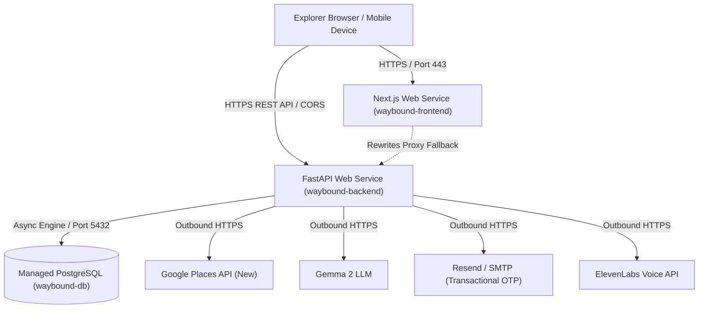

# WAYBOUND

An open-source AI adventure companion that turns nearby places into personalized real-world quests, encouraging people to explore, walk, connect, and spend more time outdoors.

---

## Architecture Overview

WAYBOUND combines a FastAPI backend with real-world geospatial intelligence, open LLMs, and a mobile-first Next.js explorer client:

- **Quest Engine & Progression APIs (Phase 1)**: User accounts, archetype profiles, progression leveling (`level = 1 + (xp // 500)`), atomic quest verification, step/hint progression, and state transitions (`draft` -> `active` -> `completed` / `abandoned`).
- **AI Game Master (Phase 2)**:
  - **Google Places API (New)** (`POST https://places.googleapis.com/v1/places:searchNearby`): Discovers real public parks, monuments, historical landmarks, museums, and botanical gardens.
  - **Minimal Field Mask**: Uses `places.id,places.displayName,places.location,places.primaryType,places.formattedAddress,places.businessStatus` to eliminate expensive review, rating, and photo billing costs.
  - **Gemma AI**: Generates RPG quest narratives and progressive clues.
  - **Anti-Hallucination & Anti-Spoofing Guardrails**:
    - Selects exclusively from real nearby candidate place IDs; rejects invented locations and hallucinated place IDs. Never silently falls back to other destinations.
    - Early clues conceal destination names and landmark identifiers.
    - Sanitized logging: Secrets, raw prompts, and raw LLM traces are never disclosed to clients or logs.
- **Explorer Frontend (Phase 3)**:
  - Mobile-first fantasy exploration web application in Next.js (App Router), TypeScript, and Tailwind CSS.
  - Native browser Geolocation integration with high-accuracy GPS coordinates and robust permission handling.
  - Progressive clue unlock flow with strict client-side destination secrecy prior to verified arrival.
  - Explorer progression dashboard (XP level progress bars, journal history, archetype crests).
  - Explicit demo mode integration and transparent ground truth safety.

---

## Provider Modes

WAYBOUND supports explicit provider modes via backend configuration (`QUEST_PROVIDER`):

| Mode | Description | Verification & Progression Behavior |
| --- | --- | --- |
| `demo` (default) | Simulated, fictional scenarios for local development and automated testing. | Observation answers verified against deterministic simulated rules; awards demo XP. Clearly labeled as simulated content. |
| `google_places_gemma` | Live Google Places candidate discovery + Gemma narrative generation. | Requires `latitude` and `longitude`. Strict failure mode: Never silently falls back to demo mode if Google Places or Gemma fails. |

---

## Real-World Verification Safety & Limitations

> [!IMPORTANT]
> **Observation Answers as Unverified Hypotheses**: LLM-generated observation questions and answers (e.g., asking what inscription date or statue feature exists at a site) are AI hypotheses and **must not be treated as trusted, field-verified ground truth**.

- **Provisional Observation Verification & Safe XP**:
  - Real-world AI-generated quests currently use **provisional observation verification**.
  - While AI observation answers remain unverified, real-world quests allow completion and destination discovery once verified at the physical site, but **award exactly 0 XP** (`reward_xp_awarded = 0`). This strictly prevents exploiting fabricated ground truth to inflate real-world explorer level/XP.
  - No client input or environment flag can override this real-world XP restriction. Simulated demo quests continue to award XP under verified deterministic test rules.
- **Geographic Proximity**: Arrival verification requires the explorer to be within `VERIFICATION_RADIUS_METERS` (default `100.0m`) calculated via the Haversine formula.
- **Search Radius Bounds**: Google Places search radius must be between `100m` and `50,000m` (default `5000m`). Unsuitable destinations (e.g. gas stations, cemeteries, storage, prisons, closed businesses) are automatically excluded.
- **Geolocation Security**: Native browser geolocation requires a secure context (HTTPS or localhost).

---

## Backend Configuration & Setup

1. Copy `.env.example` to `.env`:
```bash
cp .env.example .env
```

2. Environment variables:

| Environment Variable | Default | Description |
| --- | --- | --- |
| `DATABASE_URL` | - | Async PostgreSQL connection string (`postgresql+asyncpg://...`) |
| `QUEST_PROVIDER` | `demo` | Provider mode: `demo` or `google_places_gemma` |
| `GOOGLE_MAPS_API_KEY` | - | Google Cloud API key with Places API (New) enabled |
| `GOOGLE_PLACES_SEARCH_RADIUS_METERS` | `5000.0` | Default discovery radius in meters |
| `GOOGLE_PLACES_MIN_RADIUS_METERS` | `100.0` | Minimum allowed search radius |
| `GOOGLE_PLACES_MAX_RADIUS_METERS` | `50000.0` | Maximum allowed search radius |
| `GOOGLE_PLACES_TIMEOUT_SECONDS` | `10.0` | HTTP timeout for Google Places calls |
| `GEMMA_API_KEY` | - | API key for Gemma provider (Google AI or OpenAI compatible) |
| `GEMMA_MODEL` | `gemma-2-9b-it` | Gemma model identifier |
| `GEMMA_BASE_URL` | `https://generativelanguage.googleapis.com/v1beta` | Gemma base URL (Google AI or local vLLM/Ollama) |
| `GEMMA_TIMEOUT_SECONDS` | `30.0` | HTTP timeout for Gemma calls |
| `GEMMA_MAX_RETRIES` | `3` | Maximum retry attempts for transient Gemma API failures |
| `VERIFICATION_RADIUS_METERS` | `100.0` | Maximum arrival geofence tolerance in meters |

3. Run migrations and seed the demo explorer:
```bash
alembic upgrade head
PYTHONPATH=. .venv/bin/python3 scripts/seed_demo_user.py
```

4. Start the FastAPI backend:
```bash
PYTHONPATH=. .venv/bin/uvicorn app.main:app --host 127.0.0.1 --port 8000 --reload
```

---

## Frontend Installation & Development (Phase 3)

The Explorer Frontend is located in `frontend/`.

### 1. Installation
```bash
cd frontend
npm install
```

### 2. Environment Configuration
Create or inspect `frontend/.env.local`:
```bash
# Points to FastAPI backend (defaults to http://localhost:8000)
NEXT_PUBLIC_API_URL=http://localhost:8000
```
> [!NOTE]
> Sensitive keys like `GOOGLE_MAPS_API_KEY` and `GEMMA_API_KEY` are kept strictly server-side on the FastAPI backend and never exposed in the frontend environment.

### 3. Development Server
```bash
npm run dev
```
Open [http://localhost:3000](http://localhost:3000) in your browser (use mobile viewport emulation for the optimal touch experience).

### 4. Production Build & Linting
```bash
# Run ESLint checks
npm run lint

# Run TypeScript typecheck
npm run typecheck

# Run Frontend Vitest Suite (12 tests)
npm test

# Build production bundle
npm run build
```

---

## Demo Walkthrough Guide

Follow these steps to demonstrate the full hackathon MVP experience:

1. **Seed or Connect Demo Explorer**:
   - Run `PYTHONPATH=. .venv/bin/python3 scripts/seed_demo_user.py` to ensure the default demo explorer (`00000000-0000-0000-0000-000000000001`) exists in the database.
   - The frontend automatically selects this Explorer by default, displaying their Level, XP progress bar, and archetype.
2. **Begin Adventure**:
   - Tap **"BEGIN ADVENTURE"** on the dashboard.
   - Select your preferred duration (15, 30, or 60 min), explorer archetype (`Mystery`, `Discovery`, `Nature`, `Fitness`, `Social`), and difficulty.
   - Tap **"Acquire Current GPS Location"** to grant browser permission (in demo mode, simulated quests can also be generated without GPS).
   - Tap **"Summon Quest"**.
3. **Inspect the Draft Quest**:
   - View the generated title, immersive field transmission story, difficulty, and duration.
   - Notice the **Destination Secret**: The destination name and coordinates remain strictly sealed.
4. **Embark & Progressive Clues**:
   - Tap **"Embark on Quest (Unlock Clue #1)"**. The quest transitions to `active` and reveals the first clue.
   - Tap **"Unlock Next Clue"** to reveal subsequent hints sequentially.
5. **Verify Completion**:
   - Tap **"Verify Arrival & Answer"**.
   - Capture your verification GPS and enter the site observation answer.
   - For demo quest `Central Library Courtyard` (coords `37.779260, -122.416040`), the answer is `owl`.
   - On submission, the destination is unlocked, actual backend XP is awarded atomically, and your Explorer level advances!
6. **Real-World Safety Mode**:
   - In `google_places_gemma` mode, completions clearly display `0 XP Awarded` with a ground-truth notification to prevent progression exploitation from AI-generated hypotheses.

---

- **Voice Game Master (Phase 4A)**:
  - Spoken AI Game Master using Web Speech API with destination secrecy enforcement.
- **Social Mystery Partner (Phase 4B)**:
  - Two-player cooperative mystery quests with split, complementary clues.
  - Server-side authenticated sessions (Bearer tokens) eliminating client-supplied UUID spoofing.
  - Proof-of-Identity email OTP authentication (`POST /auth/otp/request` and `POST /auth/otp/verify`) with HMAC-SHA256 salted hashes and sliding-window rate limiting.
  - Dedicated demo authentication (`POST /auth/demo-session`) isolated to the seeded demo explorer and strictly disabled in production (`ALLOW_DEMO_AUTH=false`).
  - Active session logout and revocation (`POST /auth/logout`).
  - Strict two-member party constraint enforced via atomic database transactions and constraints.
  - Fast reservation mechanism (`generating_quest` status) that releases database row locks during external Google Places and Gemma generation.
  - Location-grounded, complementary split clues derived from real place features without generic filler.
  - Server-side independent GPS arrival verification without disclosing raw coordinates or live location to the partner.
  - Nicknames by default; mutual consent required to reveal real explorer identities.
  - Anti-exploit XP safety rule preserved: Real-world AI observation hypothesis awards 0 XP.

---

## Two-Browser Cooperative Gameplay Testing Guide

To test the two-player mystery experience locally using two browser windows (or one normal window and one incognito window):

1. **Window A (Host Explorer - "Seeker")**:
   - Navigate to [http://localhost:3000](http://localhost:3000).
   - In the top navigation toggle, switch from **"Solo Expedition"** to **"Mystery Fellowship"**.
   - Under **"Form Fellowship"**, enter Fellowship Name (e.g. `Order of the Key`) and Explorer Nickname (e.g. `Seeker`). Click **"Form Fellowship"**.
   - In the fellowship lobby, click **"Copy Secret Token"** to copy the opaque invitation token (`wb_inv_...`).
   - The lobby shows `Seeker (Host)` and displays `Waiting for a second explorer to join...`.

2. **Window B (Partner Explorer - "Scholar" / Incognito)**:
   - Navigate to [http://localhost:3000](http://localhost:3000) in an incognito window or second browser.
   - Switch to **"Mystery Fellowship"**.
   - Under **"Join Existing Fellowship"**, paste the copied invitation token and choose a nickname (e.g. `Scholar`). Click **"Join Fellowship"**.
   - The lobby updates in both windows automatically (via background synchronization) showing both explorers assembled!

3. **Window A (Host Begins Cooperative Quest)**:
   - Under **"Embark on Cooperative Quest"**, choose duration and archetype, then click **"Start Two-Player Cooperative Quest"**.
   - Both windows transition to the **Active Cooperative Quest** screen.

4. **Verify Clue Privacy & Voice Narration**:
   - Notice that Window A receives **Fragment I** (Slot 1 perspective) while Window B receives **Fragment II** (Slot 2 perspective).
   - Neither explorer's browser receives or displays the partner's clue text.
   - The Voice Game Master only reads the player's own visible clues and shared story—never the partner's hidden clues or destination secret.

5. **Mutual Consent & Identity Protection**:
   - Both players see only the partner's chosen nickname (`Seeker` and `Scholar`).
   - If Player A clicks **"Consent to Reveal Real Name"**, Player B still only sees the nickname until Player B also consents.
   - Either player can revoke consent at any time to re-cloak their identity.

6. **Server-Side Verification & Completion**:
   - Both explorers must independently click **"Verify Arrival & Answer"** to provide their GPS location and observation answer.
   - In Window A, submit coordinates `37.779260, -122.416040` and answer `owl`. Window A marks verified, while the quest remains waiting for the partner.
   - In Window B, submit the observation. Once both have verified, the quest atomically completes, destination is unveiled, and shared XP is rewarded!

---

## Phase 4C: ElevenLabs Premium Voice Game Master

WAYBOUND incorporates an optional, studio-quality Text-to-Speech integration powered by **ElevenLabs**, augmenting the free built-in browser `speechSynthesis` Voice Game Master.

### 1. Dual-Provider Architecture & Automatic Browser Fallback
- **Three Voice Modes**: Explorers can toggle between **Off**, **Browser (Free Device TTS)**, and **ElevenLabs (Studio AI)** directly from the active quest header and voice settings bar. Preferences persist automatically in `localStorage`.
- **Zero Gameplay Disruption**: If ElevenLabs is unconfigured, disabled, rate-limited, times out, or exhausts API credits, WAYBOUND automatically and gracefully falls back to browser speech synthesis. Quest gameplay, progression, and verification are never interrupted.
- **Single Playback Constraint**: A centralized, thread-safe `speechController` ensures that only one voice narration stream plays at any given time. Starting speech automatically stops prior tracks, and navigating away or abandoning quests immediately cleans up active audio.

### 2. Credit Conservation & Server-Side LRU Caching
To protect quota and optimize free-tier credit consumption:
- **Server-Side Narration Caching**: Repeated narration requests (e.g., replaying quest descriptions or unlocked clues) are cached in an in-memory LRU cache (`NARRATION_CACHE_MAX_ITEMS`, default 500 items). Cache keys incorporate `voice_id::model_id::auth_scope::text`. Cached hits avoid external ElevenLabs API calls entirely.
- **Input Length Caps**: Server-side synthesis restricts inputs to a maximum of 2,000 characters per utterance.
- **Rate Limiting**: Dedicated rate limiting (`ELEVENLABS_RATE_LIMIT_PER_MINUTE`, default 20 req/min) prevents rapid credit depletion and abuse.
- **Client Cache-Control**: Audio responses are delivered with `Cache-Control: private, max-age=3600` so client browsers cache MP3 chunks during an active quest session.

### 3. Destination Secrecy & Server-Side Security
- **Strictly Server-Side Credentials**: `ELEVENLABS_API_KEY` is kept strictly server-side and is never sent to the browser or client bundle.
- **No Arbitrary User Text Synthesis**: The `/api/v1/narration/synthesize` endpoint rejects unrestricted client-supplied text. Narration is generated exclusively from authorized, unlocked quest events (`story`, unlocked `clue`, or verified `completion`).
- **Destination Secrecy Enforced**: Hidden destination names, coordinates, and locked clues are strictly forbidden from narration.
- **Cooperative Fellowship Isolation**: In multiplayer cooperative quests, an explorer can only narrate clues assigned to their own slot; partner-private clues cannot be synthesized.

### 4. ElevenLabs API Setup & Free-Tier Guidance
1. Create an account at [elevenlabs.io](https://elevenlabs.io) and obtain an API Key from Profile -> API Keys.
2. Ensure your API key has the `text_to_speech` permission enabled.
3. Choose a Voice ID from the ElevenLabs Voice Library (e.g., `21m00Tcm4TlvDq8ikWAM` - Rachel, `pNInz6obpgDQGcFmaJgB` - Adam, or custom community voices).
4. Default recommended model: `eleven_multilingual_v2` or `eleven_turbo_v2_5` (faster and lower latency).
5. Set `ELEVENLABS_ENABLED=true` in `.env` along with your `ELEVENLABS_API_KEY`.

---

## Production Security & Architecture Limitations

1. **Authentication & Identity Proof**:
   - Unauthenticated creation of sessions via arbitrary client-supplied UUIDs is completely removed.
   - Explorers authenticate via verified email OTP dispatched through configurable transactional email providers (`resend`, `smtp`, `gmail_api`, or `simulated` for dev/test).
   - In production, simulated email delivery is strictly rejected at startup; transactional email provider credentials (`RESEND_API_KEY`, `SMTP_HOST`/`SMTP_PASSWORD`, or Gmail OAuth2 credentials) are required and kept strictly server-side.
   - OTP codes are **never** returned in API responses, logs, or error messages in production.
   - OTP records are committed only after the email provider confirms successful delivery acceptance, and are automatically rolled back upon provider errors.
   - Brute-force protection invalidates OTP codes after 5 failed attempts; replay and expired attempts are strictly rejected.
   - Demo sessions are restricted strictly to seeded demo accounts and completely forbidden when `ENVIRONMENT=production` or `ALLOW_DEMO_AUTH=false`.
   - `Settings` automatically validates at startup that `AUTH_SECRET` is at least 32 characters and does not match any default dev secrets when running in production.
2. **Multi-Worker Shared Rate Limiting**:
   - `RATE_LIMIT_STORAGE=database` coordinates sliding-window rate limiting across multi-process and multi-worker deployments via the `auth_rate_limit_entries` table.
   - Enforces IP and per-email attempt thresholds returning `429 Too Many Requests` with `Retry-After` headers.
3. **Session Revocation & Logout**:
   - Active tokens can be explicitly revoked via `POST /api/v1/auth/logout`.
   - Revoked or expired sessions are rejected immediately with 401 Unauthorized.
4. **Database Concurrency & Row Lock Safety**:
   - Cooperative quest generation uses an atomic reservation status (`generating_quest`), immediately releasing database row locks while Google Places and Gemma complete their network requests.
   - Prevents database connection starvation and transaction lock timeouts.
5. **Data Isolation & Proximity**:
   - Partner clues and raw coordinates are strictly filtered server-side in `PartyService` prior to Pydantic serialization; client bundles never receive partner clues or partner GPS coordinates over the wire.

---

## Phase 4D: Render Production Deployment

WAYBOUND is fully productionized and deployable on **Render** using Infrastructure-as-Code via the Render Blueprint (`render.yaml`).

### 1. Architecture on Render



The blueprint declares three synchronized components:
1. **`waybound-db`**: Managed PostgreSQL database (Version 16).
2. **`waybound-backend`**: FastAPI web service running Python 3.12 with Uvicorn, multi-worker concurrency, safe pre-start Alembic migrations, database-backed atomic rate limiting, and trusted reverse-proxy header evaluation.
3. **`waybound-frontend`**: Next.js App Router web service (Node 20) with baked public API URL, automatic cross-domain CORS compatibility, and fallback proxy rewrites.

---

### 2. Step-by-Step Blueprint Deployment

1. **Fork or Push to GitHub**:
   Ensure your repository has the `feat/deployment` branch merged or pushed to your default repository branch.

2. **Connect to Render**:
   - Log into your [Render Dashboard](https://dashboard.render.com).
   - Click **New +** -> **Blueprint**.
   - Connect your GitHub account and select the `itsdevcode/waybound` repository.

3. **Configure Blueprint Secrets**:
   Render will parse `render.yaml` and prompt you for the uncommitted server-side secrets:
   - **`RESEND_API_KEY`**: Your transactional email API key from [resend.com](https://resend.com) (or configure SMTP parameters).
   - **`GOOGLE_MAPS_API_KEY`** *(optional)*: Required only if `QUEST_PROVIDER=google_places_gemma`.
   - **`GEMMA_API_KEY`** *(optional)*: Required only if `QUEST_PROVIDER=google_places_gemma`.
   - **`ELEVENLABS_API_KEY`** *(optional)*: Required only if `ELEVENLABS_ENABLED=true`.

   > [!NOTE]
   > `DATABASE_URL` is automatically wired from `waybound-db`.
   > `AUTH_SECRET` is automatically generated by Render as a cryptographically strong 32+ character random secret (`generateValue: true`).
   > `CORS_ORIGINS` and `NEXT_PUBLIC_API_URL` are automatically linked between the frontend and backend services.

4. **Deploy**:
   - Click **Apply Blueprint**.
   - Render provisions the database, runs `pip install -r requirements.txt`, executes `alembic upgrade head` via `scripts/start_backend.sh`, launches Uvicorn on `$PORT`, and builds the Next.js frontend application.

---

### 3. Environment Variables Reference

| Variable | Service | Required? | Source / Description |
| --- | --- | --- | --- |
| `DATABASE_URL` | Backend | **Yes** | Auto-injected from `waybound-db`. Normalized to `postgresql+asyncpg://` at runtime. |
| `AUTH_SECRET` | Backend | **Yes** | Auto-generated by Render (`generateValue: true`). Must be >= 32 chars in production. |
| `ENVIRONMENT` | Backend | **Yes** | Defaults to `production` in blueprint. Disables demo sessions and simulated emails. |
| `ALLOW_DEMO_AUTH` | Backend | **Yes** | Set to `false` in production. Rejects unverified login attempts. |
| `RATE_LIMIT_STORAGE` | Backend | **Yes** | Set to `database` for multi-worker / multi-process synchronization with fail-closed atomic locks. |
| `WEB_CONCURRENCY` | Backend | Optional | Number of Uvicorn workers. Default: `1` (tuned for low connection footprint on small tiers). |
| `DB_POOL_SIZE` | Backend | Optional | Connection pool size per worker. Default: `5`. |
| `DB_MAX_OVERFLOW` | Backend | Optional | Max connection overflow per worker. Default: `5`. |
| `TRUSTED_PROXIES` | Backend | Optional | Trusted proxy boundary for header validation. Default: `127.0.0.1,::1,10.0.0.0/8`. |
| `CORS_ORIGINS` | Backend | **Yes** | Explicit public HTTPS frontend origin (e.g. `https://waybound-frontend.onrender.com` or custom domain). In production, wildcard `*`, empty values, and internal hostnames are strictly rejected. Configured with `sync: false` to allow dashboard customization. |
| `EMAIL_PROVIDER` | Backend | **Yes** | `resend` (recommended), `smtp`, or `gmail_api`. |
| `EMAIL_FROM` | Backend | **Yes** | Verified sender address (e.g. `WAYBOUND <auth@yourdomain.com>` or `onboarding@resend.dev`). Placeholders like `waybound.dev` are rejected. |
| `RESEND_API_KEY` | Backend | **Conditional** | Required if `EMAIL_PROVIDER=resend`. Server-side only. |
| `GMAIL_CLIENT_ID` | Backend | **Conditional** | Required if `EMAIL_PROVIDER=gmail_api`. OAuth2 client ID from Google Cloud Console. Server-side only. |
| `GMAIL_CLIENT_SECRET` | Backend | **Conditional** | Required if `EMAIL_PROVIDER=gmail_api`. OAuth2 client secret. Server-side only. |
| `GMAIL_REFRESH_TOKEN` | Backend | **Conditional** | Required if `EMAIL_PROVIDER=gmail_api`. Long-lived refresh token from the OAuth consent flow. Server-side only. |
| `GMAIL_SENDER_EMAIL` | Backend | **Conditional** | Required if `EMAIL_PROVIDER=gmail_api`. Sender address (e.g. `WAYBOUND <you@gmail.com>`). Must be the same account used in the consent flow. |
| `QUEST_PROVIDER` | Backend | Optional | `demo` (default) or `google_places_gemma`. |
| `GOOGLE_MAPS_API_KEY` | Backend | Optional | Required if `QUEST_PROVIDER=google_places_gemma`. Server-side only. |
| `GEMMA_API_KEY` | Backend | Optional | Required if `QUEST_PROVIDER=google_places_gemma`. Server-side only. |
| `ELEVENLABS_ENABLED` | Backend | Optional | Set to `true` to activate ElevenLabs TTS. |
| `ELEVENLABS_API_KEY` | Backend | Optional | Required if `ELEVENLABS_ENABLED=true`. Server-side only. |
| `NEXT_PUBLIC_API_URL` | Frontend | **Yes** | Public HTTPS backend URL (e.g. `https://waybound-backend.onrender.com` or custom domain). Baked into client bundle at build-time and used for browser API requests. Configured with `sync: false`. |
| `BACKEND_URL` | Frontend | Optional | Public HTTPS backend URL or valid absolute URL (e.g. `https://waybound-backend.onrender.com`) used by Next.js server-side rewrites. Configured with `sync: false`. |
| `NEXT_PUBLIC_GOOGLE_MAPS_API_KEY` | Frontend | Optional | Client Google Maps JavaScript API key for Interactive Quest Map. Restrict key to authorized HTTP referrers in Google Cloud Console. When omitted, WAYBOUND automatically and gracefully falls back to the built-in Tactical Radar map. |

---

### 4. Post-Provisioning Manual Configuration Checklist

Render provisions services with initial defaults. Depending on naming collisions or custom domain setups, verify and configure the following variables in the **Render Dashboard**:

1. **`CORS_ORIGINS` (Backend Service -> Environment)**:
   - Ensure this exactly matches your deployed frontend's public HTTPS origin (e.g., `https://waybound-frontend.onrender.com` or `https://explorer.yourdomain.com`).
   - If Render generated a unique slug (e.g., `waybound-frontend-xxxx.onrender.com`), update `CORS_ORIGINS` on the backend to match.
   - For multiple origins (e.g. production domain + staging domain), use comma separation: `https://waybound-frontend.onrender.com,https://explorer.yourdomain.com`.
   - *Security note*: Wildcards (`*`), empty strings, and private internal service hostnames are rejected at backend startup.

2. **`NEXT_PUBLIC_API_URL` (Frontend Service -> Environment)**:
   - Ensure this points to the public HTTPS URL of your deployed backend service (e.g., `https://waybound-backend.onrender.com` or `https://api.yourdomain.com`).
   - *Important*: Next.js inlines `NEXT_PUBLIC_*` variables into the static JavaScript bundles during `npm run build`. If you update `NEXT_PUBLIC_API_URL` in the Render Dashboard, you **must trigger a manual redeploy** on `waybound-frontend` so Next.js rebuilds with the new target.

3. **`BACKEND_URL` (Frontend Service -> Environment)**:
   - Set to the public HTTPS backend URL (e.g., `https://waybound-backend.onrender.com`) for Next.js server-side API proxy rewrites (`/api/v1/:path*`).

4. **`NEXT_PUBLIC_GOOGLE_MAPS_API_KEY` (Frontend Service -> Environment)**:
   - Optional: Provide your Google Maps Platform API key with **Maps JavaScript API**, **Geocoding API**, and **Directions API** enabled.
   - **Domain Restrictions (Crucial Security Requirement)**: In Google Cloud Console (*APIs & Services -> Credentials -> Key Restrictions*), select **Websites (HTTP referrers)** and add your specific, fully-qualified production frontend domain and local development URLs:
     - `https://waybound-frontend.onrender.com/*` (or your exact custom domain, e.g. `https://explorer.yourdomain.com/*`)
     - `http://localhost:3000/*` and `http://127.0.0.1:3000/*` (for local development testing)
     - **Do NOT** use broad wildcards like `*.onrender.com/*` or `*/*`, which leave your billing quota vulnerable to cross-origin abuse.
   - If left unconfigured or blocked, WAYBOUND renders the built-in SVG Tactical Radar map with zero build or runtime crashes.

5. **`EMAIL_FROM` (Backend Service -> Environment)**:
   - Configure your verified sender address (e.g., `WAYBOUND <auth@yourdomain.com>`) or the Resend sandbox address (`WAYBOUND <onboarding@resend.dev>`).
   - Default unverified placeholders (like `auth@waybound.dev`) fail startup validation.

5. **`RESEND_API_KEY` (Backend Service -> Environment)**:
   - Add your API key from [resend.com/api-keys](https://resend.com/api-keys).

6. **External AI Keys (Backend Service -> Environment, Optional)**:
   - `GOOGLE_MAPS_API_KEY` & `GEMMA_API_KEY`: Required if setting `QUEST_PROVIDER=google_places_gemma`.
   - `ELEVENLABS_API_KEY`: Required if setting `ELEVENLABS_ENABLED=true`.

---

---

## Phase 4E: Gmail API Email Provider

WAYBOUND supports Gmail as an alternative transactional email provider via the Gmail REST API with OAuth 2.0 authentication.

> [!NOTE]
> **Personal vs. service account**: A standard personal Gmail account is limited to roughly **500 emails per day** via the Gmail API (500 users × 1 send each). For high-volume production deployments, use **Resend** (3,000 free emails/month) or a dedicated SMTP relay instead.

### 1. Architecture

```
GmailApiEmailService
  └─ POST https://oauth2.googleapis.com/token       ← exchange refresh token → access token
  └─ POST https://gmail.googleapis.com/gmail/v1/users/me/messages/send  ← RFC-2822 base64url payload
```

Access tokens are refreshed on every OTP send request (not cached). This deliberately trades one extra HTTPS round-trip for zero stale-token risk across multi-worker deployments.

### 2. One-Time OAuth2 Setup

1. **Create a Google Cloud project** at [console.cloud.google.com](https://console.cloud.google.com).
2. **Enable the Gmail API** under *APIs & Services → Library → Gmail API → Enable*.
3. **Configure the OAuth consent screen** (*APIs & Services → OAuth consent screen*):
   - App type: **Internal** (if using Google Workspace) or **External**.
   - Add scope: `https://www.googleapis.com/auth/gmail.send`.
   - If *External* and still in **Testing mode**, add the sender Gmail address as a test user. **Note**: OAuth tokens issued in Testing mode expire after **7 days**. Publish the app to remove this limitation.
4. **Create an OAuth 2.0 Client ID** (*APIs & Services → Credentials → Create Credentials → OAuth client ID*):
   - Application type: **Web application** (or *Desktop app* for the one-time local consent step).
   - For the local consent step, add `http://localhost` as an Authorized redirect URI.
5. **Run the one-time consent flow** to obtain a refresh token:
   ```bash
   # Install the Google OAuth2 helper (dev-only, not a production dependency)
   pip install google-auth-oauthlib

   python3 - <<'EOF'
   from google_auth_oauthlib.flow import InstalledAppFlow
   import json

   flow = InstalledAppFlow.from_client_secrets_file(
       "client_secret.json",  # Downloaded from Google Cloud Console
       scopes=["https://www.googleapis.com/auth/gmail.send"],
   )
   creds = flow.run_local_server(port=0)
   print(json.dumps({
       "client_id": creds.client_id,
       "client_secret": creds.client_secret,
       "refresh_token": creds.refresh_token,
   }, indent=2))
   EOF
   ```
   Copy the printed values — these are your one-time credentials.
6. **Set backend environment variables** (never commit to source control):
   ```bash
   EMAIL_PROVIDER=gmail_api
   EMAIL_FROM="WAYBOUND <you@gmail.com>"
   GMAIL_CLIENT_ID=<your_client_id>
   GMAIL_CLIENT_SECRET=<your_client_secret>
   GMAIL_REFRESH_TOKEN=<your_refresh_token>
   GMAIL_SENDER_EMAIL="WAYBOUND <you@gmail.com>"
   ```

### 3. Refresh Token Lifecycle & Expiration

| OAuth Consent Mode | Refresh Token Lifetime |
| --- | --- |
| **Testing** (≤ 100 users, external app) | **7 days** — expires automatically. Must re-run consent flow. |
| **Published** (external, verified) | Indefinite, unless revoked or app permissions changed. |
| **Internal** (Google Workspace only) | Indefinite within the organization. |

> [!WARNING]
> If your OAuth app is in **Testing mode**, the refresh token expires after **7 days**. WAYBOUND will begin returning `EmailDeliveryError: Gmail OAuth2 refresh token is invalid or revoked` errors once it expires. To fix: either publish the app (requires Google verification for sensitive scopes) or re-run the consent flow each week.

> [!CAUTION]
> The refresh token grants access to send email as the authorized account. Treat it with the same security posture as a private key. Never commit it to source control, log it, or include it in environment files that are versioned.

### 4. Error Handling Summary

| Error Condition | Gmail API Response | WAYBOUND Behavior |
| --- | --- | --- |
| Revoked or expired refresh token | 400 `invalid_grant` | `EmailDeliveryError` — re-run OAuth consent flow |
| Wrong client ID / secret | 401 from token endpoint | `EmailDeliveryError` — check credentials |
| Gmail API quota exceeded | 429 | `EmailDeliveryError` — retry or switch provider |
| Gmail API server error | 5xx | `EmailDeliveryError` — transient; retry |
| Network timeout / DNS failure | `httpx.RequestError` | `EmailDeliveryError` — check connectivity |

---

### 5. Transactional Email & Resend Domain Verification

In production, WAYBOUND authenticates explorers using email OTPs and rejects the simulated provider:

1. **Resend Domain Setup**:
   - Go to [resend.com/domains](https://resend.com/domains) and add your custom domain (e.g., `yourdomain.com`).
   - Add the generated DNS records to your domain's DNS provider:
     - **DKIM** (TXT record for cryptographic signing)
     - **SPF** (MX / TXT record for sender authentication)
     - **DMARC** (TXT record `_dmarc.yourdomain.com` with `v=DMARC1; p=none`)
   - Once verified, set `EMAIL_FROM="WAYBOUND <auth@yourdomain.com>"` in your Render backend settings.
2. **Testing with Resend Sandbox**:
   - If deploying before custom domain DNS propagates, use Resend's pre-verified test address: `EMAIL_FROM="WAYBOUND <onboarding@resend.dev>"`.
   - *Note*: Resend sandbox only delivers emails to the email address registered with your Resend account.
3. **Security Safeguards**:
   - In production, placeholder sender addresses (such as `auth@waybound.dev` or `example.com`) cause startup validation to fail immediately.
   - OTP codes are never returned in public API payloads or application logs.

---

### 6. PostgreSQL Connection Pooling on Render

Small Render PostgreSQL instances (Free and Starter tiers) enforce strict connection limits (typically 20–50 connections):

- **Default Conservative Footprint**:
  - `WEB_CONCURRENCY=1` (1 Uvicorn worker process)
  - `DB_POOL_SIZE=5`
  - `DB_MAX_OVERFLOW=5`
  - **Total max connection usage per instance**: 10 connections, safely under the 20-connection threshold.
- **Scaling to Larger Tiers**:
  - When upgrading to **Standard** ($25/mo) or higher Render database instances, increase `WEB_CONCURRENCY=2` and `DB_POOL_SIZE=10`, `DB_MAX_OVERFLOW=10`.

---

### 7. Free Tier vs. Paid Tier & Estimated Deployment Costs

| Component | Free Tier ($0/mo) | Recommended Production ($21/mo) | Description |
| --- | --- | --- | --- |
| **PostgreSQL Database** | Free (1 GB, 30-day life) | Starter ($7/mo) | 10 GB persistent storage, automated daily backups, no expiration. |
| **FastAPI Backend** | Free (512 MB RAM) | Starter ($7/mo) | 24/7 uptime, no cold sleep, 512 MB RAM, persistent connections. |
| **Next.js Frontend** | Free (512 MB RAM) | Starter ($7/mo) | 24/7 uptime, zero-downtime rolling deploys, faster cold loads. |
| **Resend (Email)** | Free tier | Free tier ($0) | Up to 3,000 emails/month (100 emails/day) free. |
| **Google Places (New)** | Free trial credit | Pay-as-you-go ($0 with credit) | Google Cloud offers $200 monthly credit (covers ~10,000 place searches). |
| **Gemma 2 AI** | Free tier | Free tier ($0) | Google AI Studio free tier covers up to 15 RPM. |
| **ElevenLabs TTS** | Free tier | Starter ($5/mo, optional) | Free tier includes 10,000 characters/month; automatic fallback to browser speech. |
| **Total Estimated Cost** | **$0 / month** | **~$21 / month** | Full 24/7 production stack without sleep delays. |

---

### 8. Post-Deployment Verification & Smoke Tests

After deployment completes in the Render Dashboard:

1. **Verify Backend Health & Readiness**:
   ```bash
   # 1. Basic Liveness Check
   curl -i https://<your-backend>.onrender.com/health
   # Expected response: HTTP 200 {"status":"ok","app":"WAYBOUND API",...}

   # 2. Database Readiness Check
   curl -i https://<your-backend>.onrender.com/health/ready
   # Expected response: HTTP 200 {"status":"ready","database":"connected",...}
   ```

2. **Verify Frontend Loading**:
   Open `https://<your-frontend>.onrender.com` in a browser or mobile device. Confirm the fantasy adventure UI loads without console errors.

3. **Verify Authentication**:
   - Enter your email address to request a one-time login OTP.
   - Confirm receipt in your inbox and submit the code to issue a secure session.

4. **Verify Solo & Multiplayer Gameplay**:
   - Start a quest and test location coordinates verification.
   - Test Voice Game Master narration (Browser Speech or ElevenLabs if configured).
   - Test creating a Fellowship party and verifying mutual partner sync.

---

### 9. Deployment Troubleshooting Guide

| Issue / Error Message | Root Cause | Solution |
| --- | --- | --- |
| `Production configuration error: CORS_ORIGINS cannot be '*' or empty in production.` | Backend `CORS_ORIGINS` was not set, set to `*`, or left empty in Render Dashboard. | In Render Dashboard -> `waybound-backend` -> Environment, set `CORS_ORIGINS` to your frontend's public HTTPS origin: `https://<your-frontend>.onrender.com` (or your custom domain `https://explorer.yourdomain.com`). |
| `Production configuration error: CORS origin '...' must use the secure HTTPS protocol.` | Origin was configured with `http://` instead of `https://`. | Change protocol to `https://` in `CORS_ORIGINS`. Production strictly forbids insecure HTTP origins. |
| `Production configuration error: CORS origin '...' must be an actual public domain with a valid TLD...` | Internal service hostname (e.g. `waybound-frontend`) was supplied instead of the public domain. | Render internal service hostnames only work inside private networking. Enter the public URL with `.onrender.com` or your custom domain TLD. |
| Frontend API calls fail with `ERR_NAME_NOT_RESOLVED` or network error in browser | `NEXT_PUBLIC_API_URL` was not configured or points to an internal hostname. | In Render Dashboard -> `waybound-frontend` -> Environment, set `NEXT_PUBLIC_API_URL` to `https://<your-backend>.onrender.com`. Then trigger a manual frontend redeploy (`npm run build` bakes this into client bundles). |
| `Production configuration error: Insecure or unverified EMAIL_FROM address` | Default placeholder `auth@waybound.dev` was left in `EMAIL_FROM`. | Configure a verified sender on your domain or use `WAYBOUND <onboarding@resend.dev>` with your Resend account's registered address. |
| `npm error code ERESOLVE` during `npm ci` | Mismatch between Node version, `@types/node`, and Vitest peer dependencies. | The repository uses Node 24 LTS and `@types/node: ^24` aligned with `vitest@5.0.3` and `vite@8.3.4`. Ensure `npm ci` is used without `--force` or `--legacy-peer-deps`. |
| Database connection pool exhausted (`too many connections`) | Too many Uvicorn worker processes or excessive pool limits on Render Starter/Free tier. | Verify `WEB_CONCURRENCY=1`, `DB_POOL_SIZE=5`, and `DB_MAX_OVERFLOW=5` in `waybound-backend` environment variables. |

---

## Running Full Test Suites

```bash
# 1. Backend tests (67 async pytest cases covering Deployment config, ElevenLabs TTS, Auth OTP, Transactional Email, Rate Limiting, Concurrency, Split Clues, Verification, and Secrecy)
PYTHONPATH=. .venv/bin/pytest tests/ -v

# 2. Frontend tests (53 Vitest cases covering ElevenLabs playback & fallback, Voice narration, OTP Auth, Party flows, Geo safety, and Secrecy)
cd frontend && npm test

# 3. Frontend Lint and Typecheck
cd frontend && npm run lint && npm run typecheck

# 4. Production Build
cd frontend && npm run build
```


