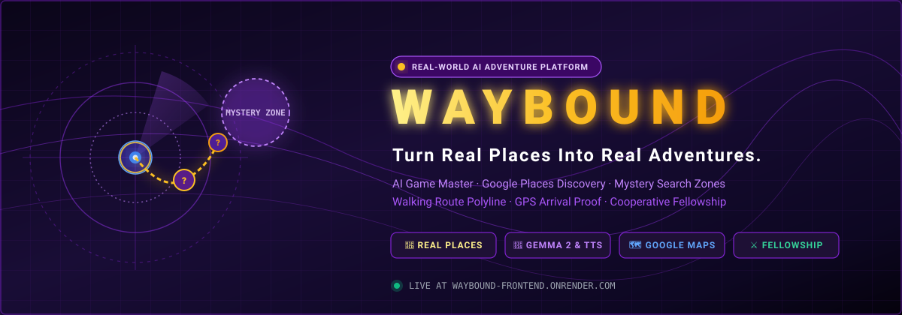
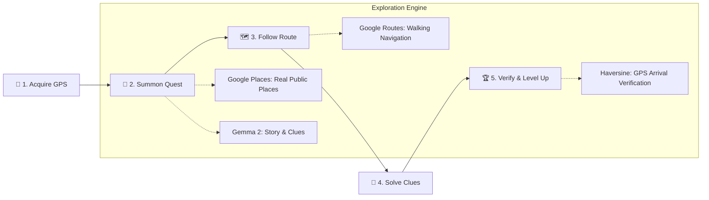
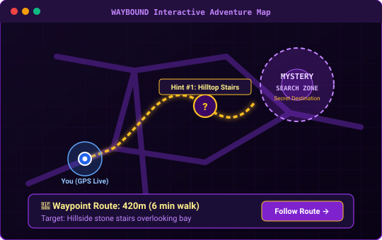
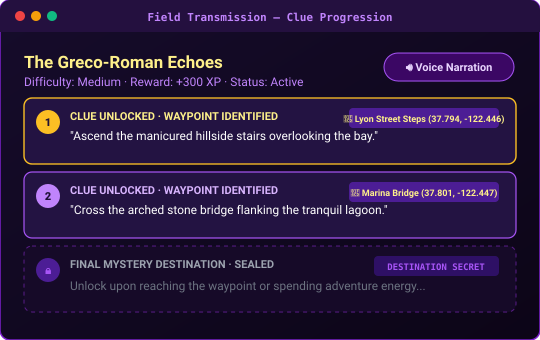
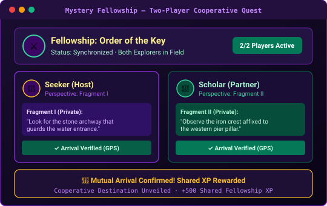
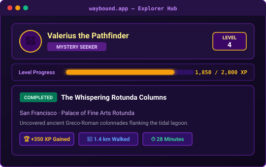

<div align="center">



# WAYBOUND

### *Turn Real Places Into Real Adventures.*
**An AI-powered real-world mystery adventure platform.**

WAYBOUND transforms ordinary neighborhood walks and nearby public landmarks into immersive, game-like mystery expeditions. Powered by open-weights Gemma AI, Google Places discovery, live GPS geolocation, and walking route navigation, WAYBOUND encourages explorers to get outside, solve environmental clues, discover hidden secrets in their cities, and team up with friends.

<!-- Quick Action Navigation -->
<p align="center">
  <a href="https://waybound-frontend.onrender.com/"></a>
  &nbsp;&nbsp;
  <a href="https://github.com/itsdevcode/waybound"></a>
  &nbsp;&nbsp;
  <a href="https://github.com/itsdevcode/waybound/issues/new?template=bug_report.md"></a>
  &nbsp;&nbsp;
  <a href="https://github.com/itsdevcode/waybound/issues/new?template=feature_request.md"></a>
</p>

<!-- Project Status & GitHub Stats -->
<p align="center">
  <a href="https://github.com/itsdevcode/waybound/stargazers"></a>
  &nbsp;
  <a href="https://github.com/itsdevcode/waybound/network/members"></a>
  &nbsp;
  <a href="https://github.com/itsdevcode/waybound/issues"></a>
  &nbsp;
  <a href="https://github.com/itsdevcode/waybound/pulls"></a>
  &nbsp;
  <a href="./LICENSE"></a>
</p>

<!-- Core Tech Stack -->
<p align="center">
  <a href="https://www.python.org/"></a>
  &nbsp;
  <a href="https://fastapi.tiangolo.com/"></a>
  &nbsp;
  <a href="https://nextjs.org/"></a>
  &nbsp;
  <a href="https://www.typescriptlang.org/"></a>
  &nbsp;
  <a href="https://www.postgresql.org/"></a>
  &nbsp;
  <a href="https://developers.google.com/maps"></a>
  &nbsp;
  <a href="https://ai.google.dev/"></a>
  &nbsp;
  <a href="https://tailwindcss.com/"></a>
</p>

</div>

---

## 🌟 Project Overview

**WAYBOUND** bridges the gap between outdoor fitness, real-world exploration, and tabletop role-playing games.

Unlike conventional navigation applications (such as Google Maps or Apple Maps) that simply give you the shortest route from Point A to Point B, **WAYBOUND deliberately keeps your final destination a secret**. Instead, it generates an unfolding mystery adventure around you:

- 🔍 **Real Locations, Never Fake Content**: Every quest is grounded in authentic, publicly accessible parks, historical monuments, public art installations, architectural landmarks, or viewpoints queried via Google Places API (New).
- 🧩 **Progressive Mystery Clues**: The AI Game Master (powered by Google Gemma 2) drafts immersive riddles and directional clues. Clues guide you through real intermediate waypoints before you uncover the secret destination.
- 🚶 **Live Walking Navigation**: Calculates actual walking routes with turn-by-turn directions, distances, and walking ETAs to active hint waypoints via Google Routes API.
- 🎯 **Proof-of-Arrival Geofencing**: To complete a quest, explorers must physically walk within the arrival geofence (server-side Haversine verification) and confirm a site-specific observation.
- 🎙️ **Narrated Exploration**: Enjoy hands-free immersion with atmospheric voice narration powered by ElevenLabs or built-in browser speech synthesis.
- ⚔️ **Cooperative Fellowship**: Team up with a partner! In multiplayer mode, each explorer receives complementary clue perspectives, requiring communication and teamwork to solve the mystery together.

---

## 🗺️ How WAYBOUND Works



1. **Enable Location**: The explorer grants browser GPS permission (or selects a target exploration city).
2. **Find an Adventure**: Choose an explorer archetype (*Mystery Seeker*, *Discovery*, *Nature Lover*, *Fitness Scout*, *Social Voyager*), duration (15, 30, or 60 min), and difficulty.
3. **Follow the Map**: The interactive purple-themed Google Map plots a mystery search zone and draws live walking routes to intermediate hint waypoints.
4. **Solve Mystery Clues**: Tap question-mark markers along your walk to inspect unlocked clue cards, listen to audio transmissions, and deduce the target.
5. **Reach Destination & Complete Quest**: Walk to the hidden landmark, verify physical arrival within the geofence, solve the observation challenge, and claim your XP!

---

## ✨ Features Section

| Feature | Description | Status |
| :--- | :--- | :--- |
| **📍 Real-World AI Quests** | Quests are generated dynamically around the explorer's real coordinates using Google Places candidates. Fictional, hallucinated, or placeholder destinations are strictly prohibited. | ✅ Production |
| **🗺️ Google Maps Adventure View** | Interactive dark purple map theme, live GPS blue marker with accuracy radius circle, and smooth map recentering. Gracefully falls back to tactical SVG radar if no key is provided. | ✅ Production |
| **🔮 Mystery Search Zones** | Translucent purple geofence boundary highlighting the general exploration area while strictly concealing the secret destination's exact coordinates. | ✅ Production |
| **❓ Clue Waypoints & Hint Markers** | Interactive question-mark markers placed at validated public waypoints. Tapping a marker opens a concise clue card with observation details. | ✅ Production |
| **🚶 Real Walking Routes & Navigation** | Uses Google Routes API to render actual walking path polylines, live walking distance (meters/km), and estimated arrival time (ETA). | ✅ Production |
| **🛡️ Server-Side GPS Arrival Proof** | Mathematical Haversine distance verification ensures the player is physically within the geofence (default 100m) before unveiling the destination. | ✅ Production |
| **⚔️ Two-Player Cooperative Fellowship** | Two-player mystery parties with complementary, split clue fragments (`Fragment I` and `Fragment II`). Each partner only sees their assigned perspective! | ✅ Production |
| **🎙️ AI Voice Game Master** | Atmospheric spoken audio narration for quest introductions, clues, and completion epilogues. Supports studio-quality ElevenLabs with zero-downtime browser TTS fallback. | ✅ Production |
| **🔐 Passwordless Email OTP Auth** | Cryptographically salted HMAC-SHA256 one-time login codes dispatched via Resend, SMTP, or Gmail API with multi-worker database rate limiting. | ✅ Production |
| **📈 Explorer Progression & Levels** | Dynamic RPG profile with XP progression bars, leveling formula ($Level = 1 + \lfloor \frac{XP}{500} \rfloor$), and journal history tracking past expeditions. | ✅ Production |
| **📱 Mobile-First Responsive Design** | Optimized for on-the-go smartphones with touch gestures, high-contrast dark theme, and battery-efficient route recalculation throttling. | ✅ Production |

---

## 📸 Screenshots & Preview

<table align="center" width="100%">
  <tr>
    <td width="50%" align="center">
      <b>🗺️ Interactive Adventure Map &amp; Walking Routes</b><br /><br />
      
      <p align="left"><sub>Real Google Maps street layout, live GPS blue dot, question-mark clue waypoints, walking path polyline, and translucent mystery search zone.</sub></p>
    </td>
    <td width="50%" align="center">
      <b>📜 Progressive Clues &amp; Waypoint Revelation</b><br /><br />
      
      <p align="left"><sub>Progressive field transmissions revealing hints sequentially. Waypoints are exposed only when unlocked, while the destination stays strictly sealed.</sub></p>
    </td>
  </tr>
  <tr>
    <td width="50%" align="center">
      <b>⚔️ Two-Player Cooperative Fellowship</b><br /><br />
      
      <p align="left"><sub>Real-time cooperative gameplay with complementary split clues (Fragment I &amp; II), privacy-preserving nicknames, and synchronized mutual completion.</sub></p>
    </td>
    <td width="50%" align="center">
      <b>📈 Explorer Progression &amp; Leveling</b><br /><br />
      
      <p align="left"><sub>Explorer archetype crests, Level progress bar with atomic XP awards, and expedition journal tracking distance, time, and discoveries.</sub></p>
    </td>
  </tr>
</table>

---

## 🛠️ Technology Stack

```
WAYBOUND ARCHITECTURE
├── Frontend (Client)
│   ├── Next.js 16 (App Router)
│   ├── React 19 & TypeScript
│   ├── Tailwind CSS & Lucide Icons
│   ├── Google Maps JavaScript API & Google Routes API
│   └── Web Speech API & HTML5 Geolocation API
│
├── Backend (REST Engine)
│   ├── FastAPI & Python 3.12 (Asynchronous REST API)
│   ├── SQLAlchemy 2.0 (Async Engine & Declarative Models)
│   ├── PostgreSQL 16 (Managed Database)
│   ├── Alembic (Database Migrations)
│   └── Pydantic v2 (Strict Schema Validation)
│
├── Geospatial & Artificial Intelligence
│   ├── Google Places API (New) (Nearby Candidate Discovery)
│   ├── Google Gemma 2 / Gemini (Procedural Narrative & Progressive Clues)
│   └── ElevenLabs TTS (Optional Studio AI Voice Narration)
│
└── Infrastructure & Security
    ├── Render Blueprint (IaC Deployment with PostgreSQL)
    ├── Resend / SMTP / Gmail API (OAuth2 Email OTP Delivery)
    └── Sliding-Window Database Rate Limiting (Multi-Worker Safe)
```

---

## 🚀 Quickstart & Local Setup

### Prerequisites
- **Python 3.12+** and `pip`
- **Node.js 20+** (or Node 24 LTS) and `npm`
- **PostgreSQL 15+** running locally (or SQLite for testing)

### 1. Backend Setup

```bash
# Clone the repository
git clone https://github.com/itsdevcode/waybound.git
cd waybound

# Create and activate virtual environment
python3 -m venv .venv
source .venv/bin/activate

# Install dependencies
pip install -r requirements.txt

# Configure environment variables
cp .env.example .env
# Edit .env to set your DATABASE_URL, GOOGLE_MAPS_API_KEY, and GEMMA_API_KEY

# Run database migrations and seed default explorer
alembic upgrade head
PYTHONPATH=. .venv/bin/python3 scripts/seed_demo_user.py

# Launch FastAPI development server
PYTHONPATH=. .venv/bin/uvicorn app.main:app --host 127.0.0.1 --port 8000 --reload
```
*Backend API docs are now available at: [http://localhost:8000/docs](http://localhost:8000/docs)*

### 2. Frontend Setup

```bash
# In a new terminal window:
cd waybound/frontend

# Install dependencies
npm install

# Configure environment
cp .env.example .env.local
# Set NEXT_PUBLIC_API_URL=http://localhost:8000
# Optionally set NEXT_PUBLIC_GOOGLE_MAPS_API_KEY

# Launch Next.js development server
npm run dev
```
*Open [http://localhost:3000](http://localhost:3000) in your browser.*

---

## 🧪 Testing & Code Quality

WAYBOUND maintains comprehensive unit, integration, and security test suites covering geospatial calculations, destination secrecy, clue unlocking, rate limiting, and TTS fallbacks:

```bash
# Run full Backend Pytest suite (133 test cases)
PYTHONPATH=. .venv/bin/pytest tests/ -v

# Run Frontend Vitest suite (74 test cases)
cd frontend && npm test

# Run TypeScript typecheck & ESLint
cd frontend && npm run typecheck && npm run lint
```

---

## 🚢 Deployment on Render

WAYBOUND is fully configured for continuous deployment on **Render** using Infrastructure-as-Code via [`render.yaml`](./render.yaml).

1. Fork this repository to your GitHub account.
2. In the [Render Dashboard](https://dashboard.render.com), click **New +** → **Blueprint**.
3. Select your fork of `waybound`.
4. Render provisions:
   - `waybound-db`: Managed PostgreSQL database.
   - `waybound-backend`: FastAPI service with automatic Alembic migrations.
   - `waybound-frontend`: Next.js web application connected via HTTPS.
5. Provide your production environment keys (`RESEND_API_KEY`, `GOOGLE_MAPS_API_KEY`, `GEMMA_API_KEY`) in the Render Dashboard.

---

## 🛡️ Anti-Hallucination & Fair Play Safeguards

> [!IMPORTANT]
> **Ground Truth Integrity**: To ensure genuine outdoor discovery, WAYBOUND enforces strict guardrails:
> 1. **Zero Invented Places**: Gemma selects destinations strictly from real Google Places candidates. Fictitious coordinates or hallucinated place IDs are rejected at the provider layer.
> 2. **Destination Secrecy**: The destination's true name and coordinates are stripped server-side prior to client serialization and never transmitted until verified arrival.
> 3. **Semantic Waypoint Validation**: Clue waypoints must be operational, publicly accessible, semantically matched with the clue riddle, and ordered reasonably along the exploration journey. If no suitable waypoint exists, a mystery search zone is shown without invented routes.
> 4. **Anti-Exploit XP Rule**: In real-world AI quest generation (`google_places_gemma`), AI observation answers are treated as hypotheses and award 0 XP to prevent exploiting unverified ground truth.

---

## 🤝 Contributing

Contributions make the open-source community an inspiring place to learn and build!
1. Fork the Project (`https://github.com/itsdevcode/waybound/fork`)
2. Create your Feature Branch (`git checkout -b feat/amazing-feature`)
3. Commit your Changes (`git commit -m 'feat: add amazing feature'`)
4. Push to the Branch (`git push origin feat/amazing-feature`)
5. Open a Pull Request

Please ensure test suites pass (`pytest` and `npm test`) before submitting PRs.

---

## 📄 License

Distributed under the **MIT License**. See [`LICENSE`](./LICENSE) for more information.

---

<div align="center">
  <sub>Built with ❤️ for explorers, hikers, and mystery lovers around the world.</sub><br />
  <b><a href="https://waybound-frontend.onrender.com/">Start Your Real-World Adventure Now →</a></b>
</div>
